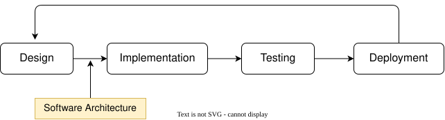

# Software Architecture

This section covers:
- Architectural styles
- Architectural patterns
- Application structure
- Architectural documentation

## Introduction

The software architecture of a system is a high-level description of:
- the system's structure
- its components
- how those components communicate with each other to fulfill the systems' **requirements**( what the system must do) and *constraints* (what the system shouldn't do).

It shows us the important components while hiding the implementation details (technologies, programming languages).

Software architecture is the output of the Design phase and the input to the Implementation phase in the Software Development Cycle.

## Why does it matter?

Software architecture impacts:
- How our product will perform and scale
- How easy it will be to add new features
- How it will respond to failures or security attacks

Not doing a good job at the design phase can:
- Waste months of engineering time
- Build a system that doesn't meet our requirements

Restructuring a system that was not architected correctly is very hard and expensive.

## Levels of abstraction

1. Classes/structs, communication between objects inside the program
2. Modules/packages/libraries
3. Services (processes / group of processes)

## Challenges

We cannot prove Software Architecture to be either **correct** or **optimal**.

What we can do to guarantee success are:
- Follow a Methodical Design Process
- Apply Architectural Patterns & Best Practices