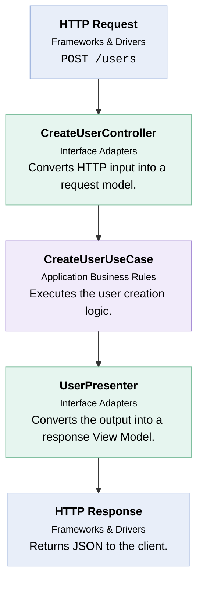

# Clean Architecture

## Introduction

Clean Architecture is a software design approach that organizes an application into layers and establishes clear dependency rules.

This makes it possible to design software systems that are maintainable, testable, flexible, and independent of frameworks and infrastructure.

For example, your business logic should not depend directly on:

- A specific database (MySQL, PostgreSQL, MongoDB).
- A web framework (Spring Boot, Express, ASP.NET).
- A user interface (React, Angular, Vue).
- An external API.
- A particular delivery mechanism (REST, GraphQL, CLI).

## Conceptual Diagram

The four major layers are:

1. **Entities**: Enterprise-wide business rules.
2. **Use Cases**: Application-specific business rules.
3. **Interface Adapters**: Convert data between use cases and external systems.
4. **Frameworks and Drivers**: Databases, web frameworks, UI, and external tools.

## Dependency rule

Source code dependencies must point inward, toward higher-level policies.

The outer layers can depend on inner layers, but inner layers must not depend on outer layers.

## Example: Create a user

## Advantages & disadvantages

| Advantages                     | Disadvantages                           |
| ------------------------------ | --------------------------------------- |
| Easier unit testing            | More initial abstractions               |
| Reduced framework coupling     | More interfaces and classes             |
| Better maintainability         | Requires architectural discipline       |
| Easier technology replacement  | Can introduce unnecessary complexity    |
| Clear separation of concerns   | May be excessive for small applications |
| Easier independent development | Requires careful boundary design        |
