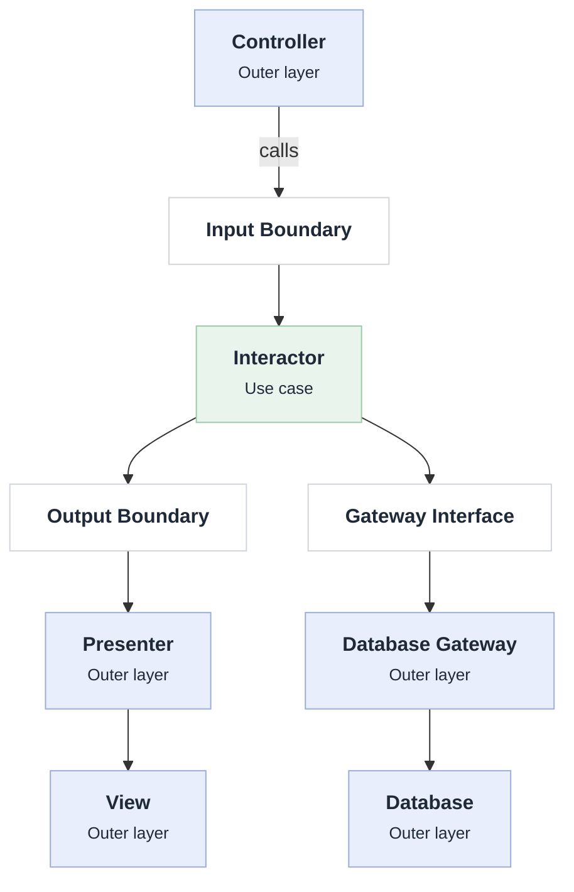

# Use Cases

## Introduction

This layer implements application-specific business rules. It defines what the application does to achieve a particular goal, without depending on external systems.


## Content

Can contain:

1. **Use Cases (Interactors):** Implement application-specific business rules.
2. **Input Boundaries:** Define interfaces for incoming requests to use cases.
3. **Output Boundaries:** Define interfaces for presenting use case results.
4. **Input Data (Request Models):** Carry data required to execute use cases.
5. **Output Data (Response Models):** Carry results produced by use cases.
6. **Gateway Interfaces:** Define contracts for accessing external systems (databases, APIs, etc.).

## Characteristics

- Defines input and output boundaries.
- Controls the execution flow of application operations.
- Coordinates Entities to accomplish business goals.
- Independent of UI and infrastructure implementation (transport, database, frameworks).
- Uses abstractions to communicate with outer layers (interface adapters).
- Changes when application behavior or requirement change.


## Dependencies

- Can depend on entities and other use cases.
- Should not depend on database, frameworks, or infrastructure implementations.


## Use Cases

A Use Case describes what the application does to achieve a particular goal. It includes:
- the input the client provides
- the output returned to the client
- the processing steps that produce that output.

For example, consider a TransferMoney Use Case. Its business requirements might be:
1. Receive the source account and destination account.
2. Validate that both accounts exist.
3. Check whether the source account has sufficient funds.
4. Deduct money from the source account.
5. Deposit money into the destination account.
6. Return the transaction result.

These steps describe the application-specific business rules.


## Use Case Interactor

The actual implementation of the application-specific business rules.

Its responsibilities are to:
1. Receive input data through an input boundary.
2. Execute the application-specific business rules.
3. Coordinate entities and external dependencies.
4. Produce output data.
5. Return the result through an output boundary.

Example:

```ts
class CreateUserInteractor implements CreateUserInputBoundary {
  constructor(
    private readonly userRepository: UserRepository,
    private readonly presenter: CreateUserOutputBoundary,
  ) {}

  execute(inputData: CreateUserInputData): void {
    const user = new User(inputData.name);
    this.userRepository.save(user);

    const outputData: CreateUserOutputData = { userId: user.id };
    this.presenter.present(outputData);
  }
}
```

The Interactor:

1. Receives input data.
2. Executes application-specific business rules.
3. Communicates with entities.
4. Uses repository interfaces to access data.
5. Sends output data to the Presenter.


## Boundary

A boundary is an interface that separates the Use Cases layer from the outer layers.

It can be:
- Input Boundary: Defines how an external layer invokes a use case.
- Output Boundary: Defines how a use case communicates its results to an external layer.
- Gateway Boundary: Defines how a use case interacts with external systems (databases, APIs, etc.).


### Input Boundary

An interface defining how an external layer invokes a use case.

Example:

```ts
interface CreateUserInputBoundary {
  execute(inputData: CreateUserInputData): void;
}
```

The Controller communicates with this interface rather than directly accessing the use case implementation.


### Output Boundary

An interface defining how the use case communicates its results to the outer (presentation) layer.

```ts
interface CreateUserOutputBoundary {
  present(outputData: CreateUserOutputData): void;
}
```

The Interactor does not know whether the result will be displayed in a web page, mobile application, or command-line interface.


### Gateway interfaces

An interface defining how a Use Case communicates with an external system or resource.

Instead of directly depending on a concrete implementation, Use Cases depend on an interface.

For example, a database Gateway:

```ts
interface UserRepository {
  save(user: User): void;
  findById(id: string): User | null;
}
```


### Input & Output Data

Input and output data are data structures that cross architectural boundaries:

- **Input Data**: Information required by Use Cases to execute. Controllers create Input Data and pass it to Input Boundaries.
- **Output Data**: Results produced by Use Cases. Interactors create Output Data and pass it through Output Boundaries to Presenters.
- **Gateway Arguments & Return Values**: Data exchanged between Interactors and external systems through Gateway Interfaces. Interactors pass arguments to Gateways and receive return values.

**Rules for input and output data**:
- Must not depend on implementation details, delivery mechanisms, or external systems.
- Should be simple data structures.
- Should contain only the minimum information required for the task. Avoid passing entire domain objects.

```ts
interface CreateUserInputData {
  name: string;
}
```


## Control flow




## Testability

Because use cases depend only on interfaces, they can be tested with stub or fake gateways.

A test can supply a fixed list of records through a fake gateway and check the use case's result directly.
