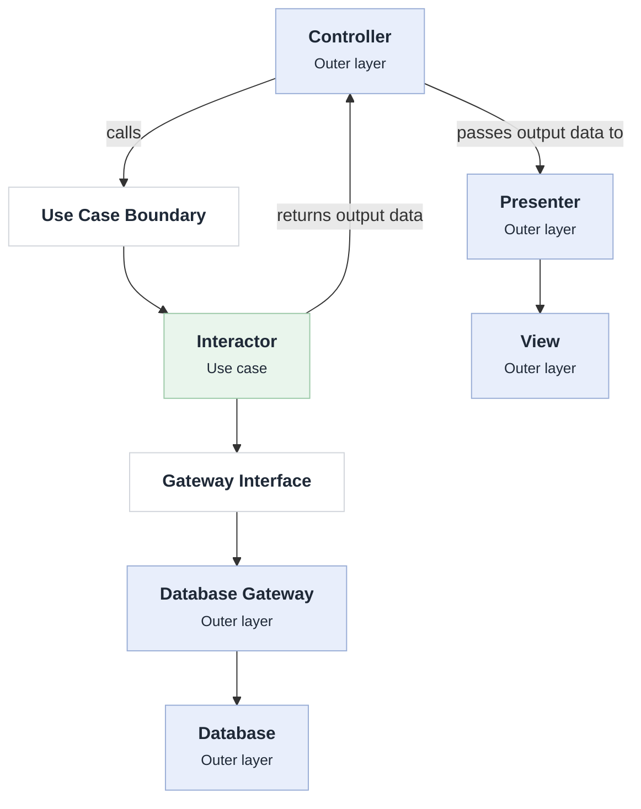

# Use Cases

## Introduction

This layer implements application-specific business rules. It defines what the application does to achieve a particular goal, without depending on external systems.


## Content

Can contain:

1. **Use Cases (Interactors):** Implement application-specific business rules.
2. **Use Case Boundary (Input and Output Boundary):** Define how a use case is invoked and how its output.
3. **Input Data (Request Models):** Carry data required to execute use cases.
4. **Output Data (Response Models):** Carry results produced by use cases.
5. **Gateway Interfaces:** Define contracts for accessing external systems (databases, APIs, etc.).

## Characteristics

- Defines input and output boundaries.
- Controls the execution flow of application operations.
- Coordinates Entities to accomplish business goals.
- Independent of UI and infrastructure implementation (transport, database, frameworks).
- Uses abstractions to communicate with outer layers (interface adapters).
- Changes when application behavior or requirement change.


## Dependencies

- Can depend on entities and other use cases.
- Should not depend on database, frameworks, or infrastructure implementations.


## Use Cases

A Use Case describes what the application does to achieve a particular goal. It includes:
- the input the client provides
- the output returned to the client
- the processing steps that produce that output.

For example, consider a TransferMoney Use Case. Its business requirements might be:
1. Receive the source account and destination account.
2. Validate that both accounts exist.
3. Check whether the source account has sufficient funds.
4. Deduct money from the source account.
5. Deposit money into the destination account.
6. Return the transaction result.

These steps describe the application-specific business rules.


## Use Case Interactor

The actual implementation of the use case.

**Responsibilities**:
1. Receive input data defined in the use case boundary.
2. Execute the application-specific business rules.
3. Coordinate entities and external dependencies.
4. Produce output data (excludes fields that the caller should not receive).
5. Return the output data to the caller.

Example:

```ts
class CreateUserInteractor implements CreateUserUseCase {
  constructor(private readonly userRepository: UserRepository) {}

  execute(inputData: CreateUserInputData): CreateUserOutputData {
    const user = new User(inputData.name);
    this.userRepository.save(user);

    return { userId: user.id };
  }
}
```

## Boundary

A boundary is an interface that separates the Use Cases layer from the outer layers.

### Use Case Boundary

An interface defining how an external layer invokes a use case and receives its output data. It serves as both the input boundary and the output boundary.

```ts
interface CreateUserUseCase {
  execute(inputData: CreateUserInputData): CreateUserOutputData;
}
```

The Controller communicates with this interface rather than directly depending on the Interactor.

:::info
Robert C. Martin's book defines an Output Boundary in the Use Case layer, implemented by the Presenter. The Interactor calls it, so the use case controls how output is presented.

This guide has no Output Boundary. The Interactor returns output data to the Controller, which calls the Presenter.

The trade-off: a simpler interactor and fewer interfaces, but the use case no longer controls output flow. Output data must stay independent of the presentation layer.
:::

### Gateway interfaces

An interface defining how a Use Case communicates with an external system or resource.

Instead of directly depending on a concrete implementation, Use Cases depend on an interface.

For example, a database Gateway:

```ts
interface UserRepository {
  save(user: User): void;
  findById(id: string): User | null;
}
```


### Input & Output Data

Input and output data are data structures that cross architectural boundaries:

- **Input Data**: Information required by Use Cases to execute. Controllers create Input Data and pass it to Use Cases.
- **Output Data**: Results produced by Use Cases. Interactors create Output Data and return it to the Controller, which passes it to a Presenter.
- **Gateway Arguments & Return Values**: Data exchanged between Interactors and external systems through Gateway Interfaces. Interactors pass arguments to Gateways and receive return values.

**Rules for input and output data**:
- Must not depend on implementation details, delivery mechanisms, or external systems.
- Should be simple data structures.
- Should contain only the minimum information required for the task. Avoid passing entire domain objects.

```ts
interface CreateUserInputData {
  name: string;
}
```


## Control flow




## Testability

Because use cases depend only on interfaces, they can be tested with stub or fake gateways.

A test can supply a fixed list of records through a fake gateway and check the use case's result directly.
