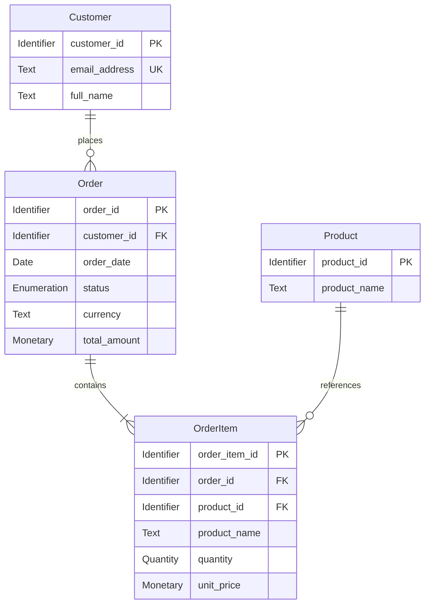

# Order Management Data Specification

## Introduction

**Overview:** The order management module supports the e-commerce purchase lifecycle: customers place orders for products, and the system records each order's items, total, and fulfillment status so the purchase can be tracked through delivery or cancellation.

**Purpose:** This document defines the business data the module uses. It establishes the meaning, allowed values, and validation rules for customer orders and their items.

## Assumptions

1. All timestamps are recorded in UTC.
2. Monetary amounts are expressed in the order's currency and use that currency's standard precision.
3. An order item retains the product name and price needed to understand the purchase after the product record changes.

## Entity-Relationship Diagram

### Customer

Represents a person who places orders.

| Name | ID | Type | Constraints | Default | Description |
| --- | --- | --- | --- | --- | --- |
| Customer ID | `customer_id` | Identifier | Required, Unique | — | Stable identifier for the customer. |
| Email Address | `email_address` | Text | Required, Unique | — | Email address used to contact the customer. |
| Full Name | `full_name` | Text | Required | — | Customer's name for order records. |

### Order

Represents a purchase placed by a customer.

| Name | ID | Type | Constraints | Default | Description |
| --- | --- | --- | --- | --- | --- |
| Order ID | `order_id` | Identifier | Required, Unique | — | Stable identifier for the order. |
| Customer ID | `customer_id` | Identifier | Required | — | Customer who placed the order. |
| Order Date | `order_date` | Date | Required | — | Date and time the order was placed, in UTC. |
| Status | `status` | Enumeration (`Order Status`) | Required | `pending` | Current fulfillment state of the order. |
| Currency | `currency` | Text | Required | — | Currency code used for the order's monetary amounts. |
| Total Amount | `total_amount` | Monetary Amount | Required, NonNegative, OrderTotal | — | Total amount payable for the order. |

### Order Item

Represents one product and quantity included in an order.

| Name | ID | Type | Constraints | Default | Description |
| --- | --- | --- | --- | --- | --- |
| Order Item ID | `order_item_id` | Identifier | Required, Unique | — | Stable identifier for the order item. |
| Order ID | `order_id` | Identifier | Required | — | Order that contains this item. |
| Product ID | `product_id` | Identifier | Required | — | Product selected for this item. |
| Product Name | `product_name` | Text | Required | — | Product name captured when the order was placed. |
| Quantity | `quantity` | Quantity | Required, Positive | — | Number of units ordered. |
| Unit Price | `unit_price` | Monetary Amount | Required, NonNegative, OrderItemCurrency | — | Price per unit in the order's currency at purchase time. |

### Product

Represents an item available for purchase.

| Name | ID | Type | Constraints | Default | Description |
| --- | --- | --- | --- | --- | --- |
| Product ID | `product_id` | Identifier | Required, Unique | — | Stable identifier for the product. |
| Product Name | `product_name` | Text | Required | — | Name shown to customers. |

## Enumerations

### Order Status

| Value | Label | Description |
| --- | --- | --- |
| `pending` | Pending | The order has been placed but not yet dispatched. |
| `shipped` | Shipped | The order has been dispatched to the customer. |
| `delivered` | Delivered | The order has been delivered to the customer. |
| `cancelled` | Cancelled | The order will not be fulfilled. |

## Constraints

| Rule ID | Trigger | Business Rule | Violation |
| --- | --- | --- | --- |
| Required | Always | A field marked Required must have a value. | Reject the record and report that the field is required. |
| Unique | Always | A field marked Unique must not duplicate the value of another record in the same entity. | Reject the record and report that the value already exists. |
| NonNegative | Always | A monetary amount must be greater than or equal to zero. | Reject the record and report that the amount cannot be negative. |
| Positive | Always | Quantity must be a whole number greater than zero. | Reject the record and report that quantity must be a positive integer. |
| OrderTotal | When an order's items are created or changed | The order total must equal the sum of each item's unit price multiplied by its quantity, using the order currency's standard precision. | Reject the change and report that the order total does not match its items. |
| OrderItemCurrency | When an order item is created or changed | Each item's unit price must use the currency of its order. | Reject the change and report that the item currency must match the order currency. |

## Revision History

| Version | Date | Author | Changes |
| --- | --- | --- | --- |
| 1.0 | 2026-10-07 | Documentation Team | Initial example covering customers, orders, products, and order items. |
