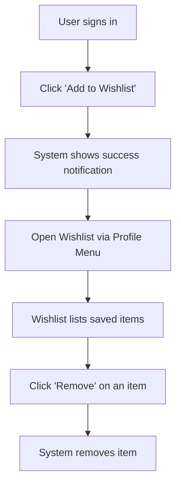

# Wishlist

## Introduction
- **Description:** Lets users to save products they are interested in for future reference.  
- **User Goal:** Track items to buy later without adding them to the cart.  
- **Related Features:** Shopping cart, product detail page, user account.

## User Story
- *As a registered shopper, I want to add products to my wishlist so that I can easily find and purchase them later.*

## Scope
- **Inclusions:**  
  - Add and remove items.  
  - View saved items.  
  - Keep items across sessions (requires login).  
- **Exclusions:**  
  - Sharing wishlists with other users.  
  - Price alerts.  

## Dependencies
- Requires user login to tie items to an account.
- Requires product catalog data (name, price, image, stock status).
- Saved items must persist per user across sessions.

## User Flow
1. User signs in.
2. User clicks "Add to Wishlist" on a product. System shows "Added to Wishlist".
3. User opens the Wishlist from the Profile Menu. System lists saved items.
4. User clicks "Remove" on an item. System removes it.

## Acceptance Criteria
- Wishlist items persist after logout/login.  
- A success notification appears only after adding an item.  
- Wishlist shows each item's name, price, and image.  
- Items of deleted products are removed automatically, and an alert shows how many were removed.  

## Alternate Flows
- **Guest User:** If not logged in, system asks the user to sign in before saving.  
- **Out-of-Stock Item:** If an item becomes unavailable, the Wishlist shows an "Out of Stock" label.  
- **Deleted Product:** The item is removed automatically, and an alert shows how many items are no longer available.  
- **Duplicate Entry:** System shows the success notification and does not add a second entry.  
- **Error:** If the product is not found or the connection fails, system shows "Unable to add item. Please try again."  

## Related Documents
- [Project Overview](./project-overview.mdx)
- [UI Specification](./ui-spec.mdx)
- [API Specification](./api-spec.mdx)
