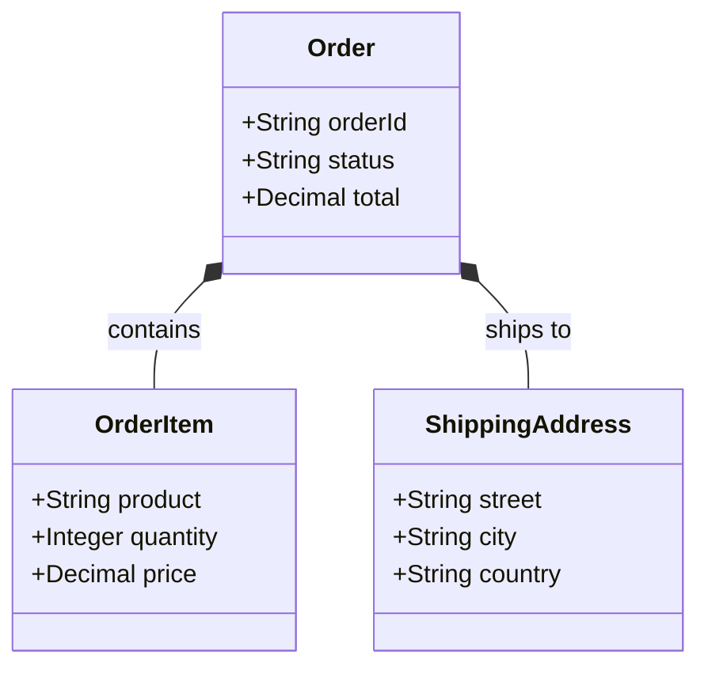

# Domain-Driven Design

## Introduction

Domain-Driven Design (DDD) is an approach to designing software around the **business domain** rather than organizing everything around technical concerns (frameworks, libraries, or infrastructure).


## Domain

A **domain** is the business area your software is trying to solve.

Examples:

| Business      | Domain                                   |
| ------------- | ---------------------------------------- |
| E-commerce    | Selling products online                  |
| Banking       | Managing financial transactions          |
| Food delivery | Ordering and delivering food             |
| Gaming        | Managing players, matches, and purchases |
| Hospital      | Managing patients and medical operations |

A domain can contain multiple subdomains. For example, an e-commerce domain might contain:

- **Catalog**: Product information
- **Ordering**: Customer orders
- **Payment**: Payment processing
- **Inventory**: Stock management
- **Shipping**: Order delivery
- **Customer**: Customer accounts

### Core Domain

The business capability that gives the company its competitive advantage. This is where you should invest the most engineering effort.

Example:

- For an online marketplace, its recommendation or marketplace-matching logic might be core.
- For a food delivery company, its delivery optimization might be core.

### Supporting Subdomain

Business functionality that supports the core domain but doesn't differentiate the business.

Examples:

- Order management
- Inventory management
- Customer management

### Generic Subdomain

Common functionality that many businesses need.

Examples:

- Authentication
- Email notifications
- Logging
- Payment gateway integration

You may use existing products or third-party solutions for generic subdomains rather than building everything yourself.


## Bounded Context

A **Bounded Context** is an explicit boundary within which a particular business model and its terminology have a consistent meaning.

For example, the `Product` model in an e-commerce application:

In the **Catalog** context:

```json
{
  "productId": "P001",
  "name": "Gaming Laptop",
  "description": "High-performance laptop",
  "price": 1500,
  "category": "Electronics"
}
```

In the **Ordering** context, a product might look like:

```json
{
  "productId": "P001",
  "productName": "Gaming Laptop",
  "unitPrice": 1500,
  "quantity": 2
}
```

In the **Inventory** context:

```json
{
  "productId": "P001",
  "warehouseId": "W001",
  "availableQuantity": 25,
  "reservedQuantity": 5
}
```

:::note
Each context has different responsibilities, you shouldn't force all three contexts to share one giant model.
:::

One guideline for Microservice design: **One bounded context = one independently deployable microservice.**


## Ubiquitous Language

Ubiquitous Language means using a shared vocabulary between developers, business analysts, and domain experts.

:::tip
Build a glossary of business terms before designing your service interfaces.
:::


## Entity and Value Object

### Entity

An Entity is an object that has a unique identity throughout its lifecycle.

An entity is identified by its identity, not simply by its attributes.

For example, an **Order**:

```java
class Order {
    private OrderId id;
    private OrderStatus status;
    private List<OrderItem> items;
}
```

Two orders can contain exactly the same items but still be different orders because they have different IDs.

### Value Object

A Value Object is an object defined by its attributes rather than a unique identity.

Value Objects should generally be immutable.

Example:

```java
class Money {
    private BigDecimal amount;
    private Currency currency;
}
```

Two Money objects with the same amount and currency are considered equal by value.

### Entity vs. Value Object

| Entity         | Value Object            |
| -------------- | ----------------------- |
| Has identity   | No independent identity |
| Has lifecycle  | Usually immutable       |
| Equality by ID | Equality by attributes  |
| Example: Order | Example: Money          |


## Aggregate and Aggregate Root

An **Aggregate** is a group of related domain objects treated as a consistency boundary.

The **Aggregate Root** is the entity through which external code accesses and modifies that aggregate.



Instead of allowing external code to modify individual OrderItems directly, you expose business operations through Order.

```java
class Order {
    private OrderId id;
    private OrderStatus status;
    private List<OrderItem> items;

    public void addItem(Product product, int quantity) {
        if (quantity <= 0) {
            throw new IllegalArgumentException();
        }

        items.add(new OrderItem(product, quantity));
    }

    public void confirm() {
        if (items.isEmpty()) {
            throw new IllegalStateException("Order is empty");
        }

        this.status = OrderStatus.CONFIRMED;
    }
}
```

### Aggregate Rules

1. External objects should modify an aggregate through its root.
2. An aggregate should protect its own invariants.
3. Keep aggregates relatively small.
4. Reference other aggregates by ID rather than embedding their entire object graphs.
5. Avoid transactions spanning multiple aggregates when possible.

:::info
Aggregates help define transaction boundaries inside a service. They don't automatically define microservice boundaries.
:::


## Repository

A Repository provides an abstraction for retrieving and persisting domain objects.

Instead of putting database queries directly inside your business logic, you define an interface that describes what your domain needs.

A Repository should generally work with domain objects and have meaningful collection-like operations.

For example:

```java
public interface OrderRepository {
    Optional<Order> findById(OrderId id);

    void save(Order order);
}
```

An implementation might look like:

```java
@Repository
public class JpaOrderRepository implements OrderRepository {

    private final SpringDataOrderRepository repository;

    @Override
    public Optional<Order> findById(OrderId id) {
        return repository.findById(id.value())
            .map(OrderMapper::toDomain);
    }

    @Override
    public void save(Order order) {
        repository.save(OrderMapper.toEntity(order));
    }
}
```

Important concepts:

- Repository interface: Domain-facing abstraction.
- Repository implementation: Infrastructure concern.
- Database: Persistence mechanism.

:::note
Don't confuse a DDD Repository with a generic DAO that exposes every possible database operation.
:::


## Service

### Domain Services

A Domain Service contains business logic that doesn't naturally belong to a particular Entity or Value Object.

For example, imagine a pricing calculation involving several domain concepts.

```java
public class PricingService {

    public Money calculateFinalPrice(
        Order order,
        Customer customer
    ) {
        // Business pricing rules
        // Customer discount
        // Order discount
        // Final price calculation
    }
}
```


### Application Service

An Application Service coordinates a use case.

Its responsibilities include:

- Loading domain objects.
- Calling domain behavior.
- Managing the use-case workflow.
- Saving changes.
- Coordinating transactions.
It doesn't contain complex business rules.

Example:

```java
@Service
public class PlaceOrderUseCase {

    private final OrderRepository orderRepository;

    public void execute(PlaceOrderCommand command) {

        Order order = Order.create(
            command.customerId()
        );

        order.addItem(
            command.productId(),
            command.quantity()
        );

        orderRepository.save(order);
    }
}
```


### Domain Service vs. Application Service

| Domain Service                 | Application Service                     |
| ------------------------------ | --------------------------------------- |
| Contains domain/business logic | Coordinates use cases                   |
| Works with domain objects      | Calls domain objects and services       |
| Independent of infrastructure  | May depend on infrastructure interfaces |
| Example: Calculate discount    | Example: Place order                    |

**Application Services coordinate. Domain Objects enforce business rules. Domain Services handle business rules that don't belong naturally to one object.**


## Domain Events

A Domain Event represents something meaningful that happened in the business domain.

A Domain Event should generally be named in the past tense because it represents something that has already happened.

Examples:

- OrderPlaced
- PaymentCompleted
- InventoryReserved
- OrderCancelled
- ShipmentDispatched

For example:

```
public record OrderPlaced(
    UUID orderId,
    UUID customerId,
    BigDecimal totalAmount
) {}
```

When an order is placed, your domain can raise an event:

```java
public class Order {

    private List<DomainEvent> events = new ArrayList<>();

    public void place() {
        // Validate business rules

        this.status = OrderStatus.PLACED;

        events.add(
            new OrderPlaced(
                id.value(),
                customerId.value(),
                totalAmount()
            )
        );
    }
}
```

### Domain Event vs. Integration Event

| Domain Event                        | Integration Event                        |
| ----------------------------------- | ---------------------------------------- |
| Internal to a bounded context       | Shared with other bounded contexts       |
| Represents a domain fact            | Represents a fact other services need    |
| Can contain internal domain details | Should expose a stable external contract |
| Often handled in-process            | Often published through a message broker |


For example:

```
Ordering Context
       |
       v
  OrderPlaced
       |
       v
Integration Event: OrderCreated
       |
       v
   Message Broker
       |
       +------> Payment Service
       |
       +------> Inventory Service
       |
       +------> Notification Service
```


## Context Mapping

Context Maps show how Bounded Contexts communicate/relate to one another.

Here are some common patterns:

### Customer-Supplier

One context provides information or functionality that another context depends on.

Example:

- Catalog provides product information.
- Ordering consumes product information.


### Anti-Corruption Layer

An Anti-Corruption Layer protects your domain model from an external system's model.

Imagine integrating with an external payment gateway (Stripe, for example).

The gateway returns:

```json
{
  "transaction_state": "CAPTURED",
  "gateway_reference": "TX123"
}
```

Your **Payment** domain uses:

```json
enum PaymentStatus {
    PENDING,
    COMPLETED,
    FAILED,
    REFUNDED
}
```

Instead of allowing gateway-specific terminology to spread throughout your domain, create an adapter:

```java
public PaymentStatus mapStatus(String gatewayStatus) {
    return switch (gatewayStatus) {
        case "CAPTURED" -> PaymentStatus.COMPLETED;
        case "PENDING" -> PaymentStatus.PENDING;
        case "DECLINED" -> PaymentStatus.FAILED;
        default -> throw new IllegalArgumentException();
    };
}
```

This isolates external dependencies.


### Shared Kernel

Two bounded contexts share a small, explicitly agreed-upon part of their domain model.

Use this carefully.

Sharing too much code creates tight coupling between services.
